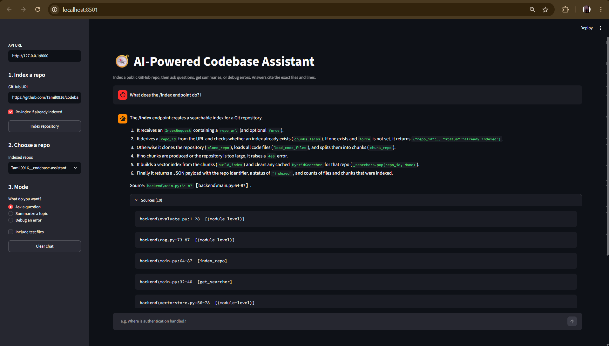

# AI-Powered Codebase Assistant

Paste a public GitHub repo URL, then **ask questions, summarize topics, or debug errors**.
Answers are grounded in the repo's actual code and cite exact files and line numbers.

> Built as a GenAI capstone: a RAG pipeline with code-aware chunking, hybrid search,
> reranking, a FastAPI backend and a Streamlit UI.



## Features

- **Index any public GitHub repo** from the UI (shallow clone, chunk, embed)
- **Three modes:** Ask a question, Summarize a topic, Debug an error
- **Citations on every claim** in the form `[file:start-end]`, with an expandable sources list
- **Honest answers:** says "I couldn't find that in the indexed code" instead of guessing
- **Multi-repo:** each repo has its own index

## Architecture

```
GitHub URL
   |
   v
Clone  ->  Parse code  ->  Chunk by function/class (AST)  ->  Embed (MiniLM)  ->  FAISS index
                                                                                      |
Question -> (query expansion) -> Hybrid search (BM25 + vectors, RRF) -> Cross-encoder rerank
                                                                                      |
                                                       Top chunks + prompt -> LLM (Groq) -> Answer + citations
```

| Layer | Tech |
|---|---|
| UI | Streamlit |
| API | FastAPI |
| Chunking | Python `ast` (functions, classes, methods, module-level code) |
| Embeddings | Sentence Transformers `all-MiniLM-L6-v2` |
| Vector store | FAISS |
| Keyword search | BM25 (`rank-bm25`) with camelCase/snake_case-aware tokenizer |
| Reranker | Cross-encoder `ms-marco-MiniLM-L-6-v2`, fused with the hybrid ranking |
| LLM | Groq (model set via `GROQ_MODEL`) |

## Design decisions and results

**Code-aware chunking.** Chunks follow function and class boundaries instead of fixed sizes, and
each carries file path, symbol name and line range, so citations are exact.
An early version dropped module-level code (constants, error messages), which hid the
source of a `RuntimeError` message. Indexing module-level code fixed that.

**Retrieval evaluation** (17 hand-written questions about Flask, "is the right function in the top 6?"):

| Method | hit@6 | MRR |
|---|---|---|
| Vector only | 14/17 (82%) | 0.56 |
| Hybrid (BM25 + vectors) | 15/17 (88%) | 0.61 |
| Hybrid + reranker | 16/17 (94%) | 0.79 |
| Hybrid + reranker, rank-fused | 17/17 (100%) | 0.74 |

Run it with `python backend/evaluate.py`.
Caveat: the questions are few and I tuned the pipeline while looking at them, so treat
these numbers as indicative, not as general accuracy.

**Hallucination control.** Prompts restrict answers to the retrieved snippets, require citations,
and tell the model its context is partial. A test question about WebSockets (not in Flask)
correctly returns "I couldn't find that".

## Limitations

- Broad enumeration questions ("list all endpoints") can be incomplete, because the model
  only sees the top retrieved chunks. The assistant says so instead of claiming completeness.
  Specific questions ("what does the /index endpoint do?") work well.
- Query expansion uses an LLM call, so it adds latency and can add noisy keywords.
- Mostly tuned on Python. Other languages fall back to generic text splitting.
- Public GitHub repos only, with a size limit for laptop-scale indexing.

## Run it locally

```bash
git clone https://github.com/Tamil0916/codebase-assistant.git
cd codebase-assistant
python -m venv venv
venv\Scripts\activate          # Windows
pip install -r requirements.txt
copy .env.example .env         # then add your Groq API key
```

Start the backend and the UI in two terminals:

```bash
uvicorn main:app --app-dir backend --port 8000
streamlit run frontend/app.py
```

Open http://localhost:8501, paste a GitHub URL in the sidebar and click **Index repository**.

## API

| Endpoint | Purpose |
|---|---|
| `POST /index` | Clone, chunk and index a public GitHub repo |
| `GET /repos` | List indexed repos |
| `POST /ask` | Answer a question (`ask`, `summarize` or `debug` mode) with sources |

Interactive docs at http://127.0.0.1:8000/docs.

## Project structure

```
backend/
  ingest.py       clone repo, collect code files
  chunker.py      AST-based chunking
  vectorstore.py  embeddings + FAISS
  hybrid.py       BM25 + vector search with rank fusion
  rerank.py       cross-encoder reranking
  rag.py          prompts, retrieval, LLM call
  main.py         FastAPI app
  evaluate.py     retrieval evaluation
frontend/app.py   Streamlit UI
```

## Future work

- Deploy a hosted demo
- Index a repo's functions together with their decorators and docstrings for better endpoint-style questions
- Larger evaluation set across several repos and languages
- Amazon Bedrock as an alternative LLM backend